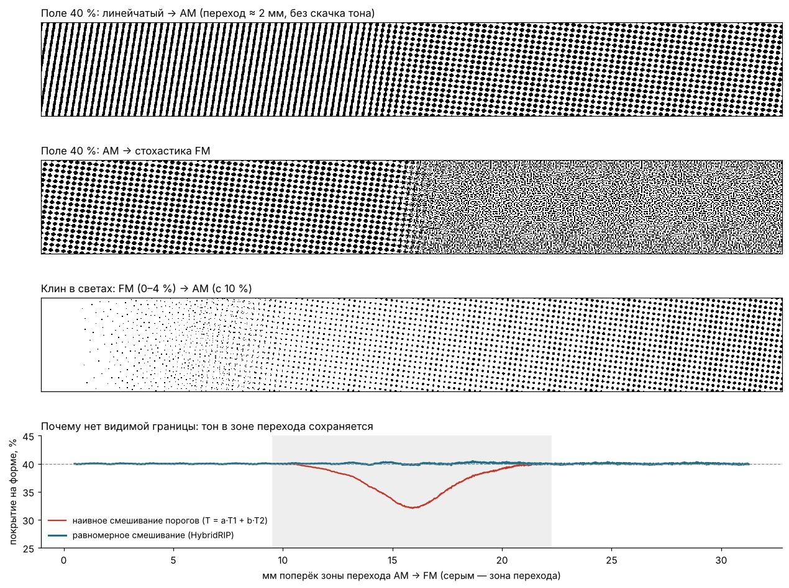

# HybridRIP — гибридное растрирование для флексографии

Прототип растрового процессора: контоновая сепарация → **1-битный TIFF**, в котором
в разных местах формы работают разные растры — **регулярный (AM)**, **линейчатый**
и **стохастический (FM)** — с **плавным, незаметным переходом** между ними.
Выбор растра задаётся критериями (тон, детальность изображения, маски/области).



## Как устроено и почему нет резких границ

1. **Пороговые матрицы с равномерным распределением.** Каждый растр — это порог
   `T(x,y) ∈ [0,1)` в каждом пикселе устройства; пиксель печатает, если `тон > T`.
   - AM: иррациональный растр (любой угол и линиатура), формы точки `euclid`,
     `round`, `ellipse` (цепная), `square`; spot-функция переводится в равномерный
     порог через её функцию распределения.
   - Линейчатый: та же схема со spot-функцией линии.
   - FM: blue-noise маска (void-and-cluster, 128×128), элемент `element_px`×`element_px`
     пикселей (во флексо одиночный пиксель 10 мкм не держится — берите 2–3 px при 2400 dpi).

2. **Карта весов** `w_am, w_line, w_fm` (сумма = 1) по критериям, затем **сглаживание
   по площади** (`transition_mm` — ширина перехода по уровню 10–90 %).

3. **Смешивание порогов без сдвига тона.** Простое `a·T1 + (1−a)·T2` даёт в зоне
   перехода провал/горб тона до 12 % — это и есть видимая граница. Здесь смешанный порог
   прогоняется через точную функцию распределения смеси (аналитически для независимых
   растров, по измеренным таблицам — для AM+линейка под одним углом), поэтому порог снова
   равномерный и **покрытие = тону при любой доле растров** (ошибка < 0,1 %, см. `tests/`).
   Геометрически точки AM постепенно получают стохастический край и распадаются на
   FM-элементы, а линии «рвутся» в точки.

   Альтернативный режим `"blend_mode": "dither"` — попиксельный выбор растра по blue-noise
   маске с вероятностью = весу.

4. **Тоновая коррекция и минимальная точка смешиваются тоже.** У AM и FM во флексо разное
   растискивание: у каждого растра своя кривая `curve` и `min_dot`, в зоне перехода
   применяется взвешенная кривая — без скачка тона на оттиске.

5. **Большие форматы.** Веса растров считаются на грубой управляющей сетке
   (`control_ppi`, по умолчанию 150 ppi), попиксельный расчёт идёт полосами на всех
   ядрах процессора (Numba), упакованные биты сразу пишутся в TIFF
   (LZW по умолчанию, также Deflate / PackBits / без сжатия; полосы сжимаются параллельно;
   MinIsWhite: 1 = печатающий элемент; BigTIFF > 3,5 ГБ).
   Пример: сепарация 1050×590 мм, 2400 dpi (99212×55748 px) — ~2,5 мин на 2 ядрах,
   до 1,8 ГБ памяти; на 8 ядрах примерно вчетверо быстрее.

## Запуск

**Окно (tkinter):** `python gui.py` — выбрать файл, задать dpi/lpi/границы тонов, нажать «Растрировать».
Кнопка «Тестовая шкала» подставляет пример из `examples/`. На Linux может понадобиться пакет `python3-tk`.

**Просмотр результата:** `python viewer.py *.tif` или кнопка «Просмотр TIFF» — наложение сепараций цветом,
масштаб, перетаскивание, сдвиг сепарации стрелками для проверки совмещения. Читает 1-бит TIFF с LZW, Deflate, PackBits.

**Командная строка:**

```bash
pip install -r requirements.txt   # numpy scipy opencv tifffile pillow numba
python -m hybridrip вход.tif -c configs/flexo_default.json -o out/
# опции: --dpi 2540 --ppi 300 --mode dither --transition 2.0
```

Вход: TIFF CMYK/Grayscale 8/16 бит (каналы и InkNames берутся из файла), PNG/JPG;
PDF/PS — через Ghostscript `tiffsep` (включая плашечные краски, нужен установленный `gs`,
этот путь в прототипе не проверялся).

Выход в `out/`: `<имя>_<сепарация>.tif` + `preview/`:
`*_preview.png` (форма, уменьшенная), `*_weights.png` (карта растров: красный — AM,
зелёный — линейка, синий — FM), `*_cropN.png` (фрагменты 1:1) и `*_report.json`
(покрытие ожидаемое/фактическое, статистика детальности для настройки порогов).

Тест: `cd examples && python make_testchart.py && cd .. &&
python -m hybridrip examples/testchart_cmyk.tif -c examples/testchart_config.json -o examples/out`

## Компенсация растискивания (по полимерам)

Кривые компенсации берутся из **файлов промеров** в папке `compensation/` — один файл на
полимер / процесс. Имена файлов показываются в выпадающем списке «Компенсация» в окне;
кнопка **★ По умолчанию** сохраняет выбор в `settings.json`, он подставляется при каждом запуске
(и в командной строке: `--comp ИМЯ`, `--comp none`, `--list-comp`).

Как сделать файл для нового полимера:
1. **Шкала для промера** — 1-бит TIFF с рядами плашек AM / FM / линейка (0–100 %, 23 ступени),
   растрированных без компенсации и без мин. точки, и шаблон `template_*.csv`.
   Делайте при тех же dpi, lpi и FM-элементе, что и в работе.
2. Вывести на форму, изготовить, промерить плашки (прибор для форм или оттиск), вписать % в шаблон.
3. Сохранить под именем полимера и **Добавить промер…** (или просто положить в папку).
4. **График** — промер и рассчитанная кривая; **Контрольная шкала** — та же шкала с компенсацией,
   на форме должны получиться заданные проценты.

Формат файла: CSV, `;`, десятичная запятая допускается, кодировка UTF-8 или Windows-1251:
`target;am;fm;line` (или одна колонка `measured` на все растры, необязательная `aim` — желаемый
результат). Строки `# min_dot_am: 2` задают мин. точку. Кривая считается как обратная к измеренной
после монотонного сглаживания шума. Проверка на модели пластины: после компенсации отклонение
≤ 0,25 % на 3–100 %. `EXAMPLE_synthetic.csv` — демонстрационный, рассчитан по модели, не для печати.

## Конфигурация (основное)

| Параметр | Смысл |
|---|---|
| `dpi` | разрешение устройства (2400 / 2540 / 4000 / 4800) |
| `compression` | `lzw` (по умолчанию), `deflate`, `packbits`, `none` |
| `input_ppi` | разрешение рендера PDF / входа (для PDF по умолчанию 600) |
| `control_ppi` | разрешение сетки весов (150; больше — точнее критерий детальности, больше памяти) |
| `transition_mm` | ширина перехода между растрами |
| `screens.am.lpi / shape` | линиатура и форма AM-точки |
| `screens.line.angle_offset` | угол линейки относительно угла канала |
| `screens.fm.element_px` | размер FM-элемента в пикселях устройства |
| `screens.*.curve / min_dot` | кривая (если не выбран файл компенсации) и минимальная точка для каждого растра |
| `angles` | углы по сепарациям (по умолчанию флексо: C 67.5, M 37.5, Y 82.5, K 7.5) |
| `criteria.tone.anchors` | `[тон, растр]` — какой растр в каком диапазоне тонов; между опорами плавно |
| `criteria.detail` | `low/high` — порог «детальности» (градиент тона на мм) для перехода в FM; значения для своих файлов смотрите в отчёте `detail_p50_p95` |
| `criteria.masks` | `{"file": "mask.png", "screen": "line"}` (светлое = применить) или `{"rect_mm": [x,y,w,h], "screen": "fm"}` |

## Что дальше для производственной версии

- **Интерпретатор PDF**: сейчас растрируется готовая контоновая сепарация. Для производства
  нужен рендер PDF/X-4 на разрешении устройства (Ghostscript, Adobe PDF Library, MuPDF),
  чтобы векторные края и текст не проходили через апсемплинг; критерии можно расширить
  объектами PDF (текст/штрих-коды → свой растр, изображения → FM/AM).
- **Скорость**: дальше — GPU (вычисление попиксельное, параллелится идеально).
- **Флексо-специфика**: микроструктура плашек (surface screening), FM второго порядка
  (рост элемента с тоном), калибровка по измеренным шкалам, выход LEN/TIFF под конкретный CDI.
- **Муар с анилоксом**: проверить линиатуру/углы против линиатуры анилокса.
